# EasyTuber Animation Studio

[](https://github.com/pjcjonas/EasyTuberAnimationStudio/actions/workflows/test.yml)
[](https://github.com/pjcjonas/EasyTuberAnimationStudio/releases/latest)

Make [EASY-TUBER](https://github.com/pjcjonas/EasyTuber) actions by keyframing them on the real rig, then export the action file.

The preview *is* EasyTuber: the studio runs EasyTuber's own renderer, idle animator and action engine (copied unmodified into `runtime/easytuber/`) and plays the exact file it is about to export. What you see is what EasyTuber, the stage window and OBS will show.

## Download

Get the zip for your computer from the [latest release](https://github.com/pjcjonas/EasyTuberAnimationStudio/releases/latest): Windows x64, or macOS (Apple silicon / Intel). The release notes say how to open it the first time (the apps aren't code-signed yet).

## Run it from source

```
npm install
npm start
npm test        # the exported code, run in EasyTuber's action engine
```

## Walkthrough: your first action

This walks through making a short wave from start to finish. The pictures are from the real app (`npm run screenshots` takes them again).

### 1. The screen

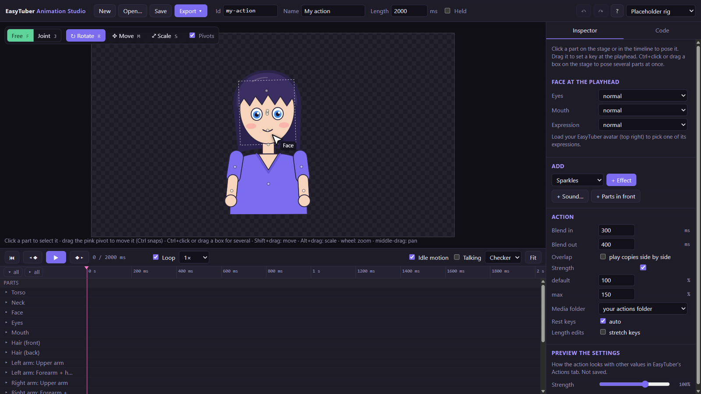

- **Stage** (middle): the avatar you are animating, drawn by EasyTuber's own renderer.
- **Posing tools** (top left of the stage): **Free** / **Joint** motion, then **Rotate**, **Move** and **Scale**.

  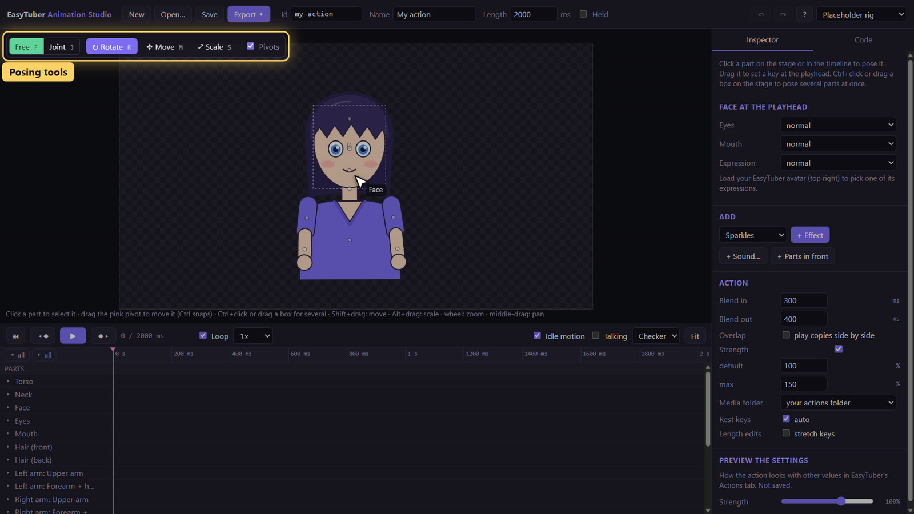

- **The action** (top bar): the **Id** becomes the file name, the **Name** is what EasyTuber's Actions tab shows, and the **Length** is in milliseconds.

  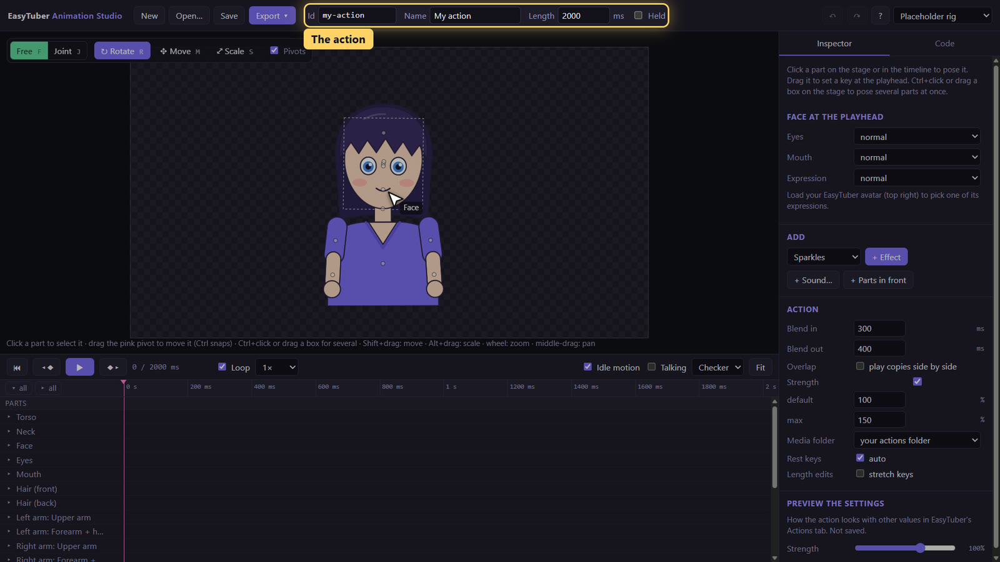

- **Timeline** (bottom): one row per body part. The yellow diamonds are keyframes.

  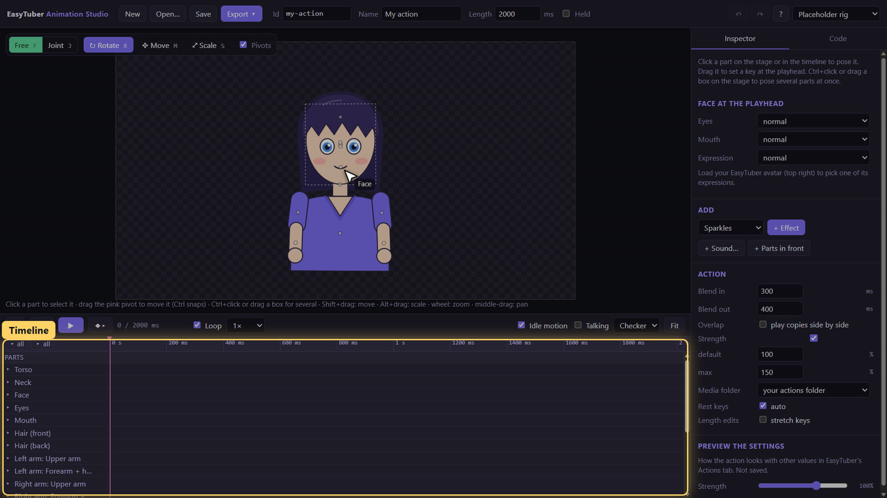

- **Inspector** (right): the exact numbers of whatever is selected, and the settings of the whole action. The **Code** tab next to it shows the file the studio will export.

  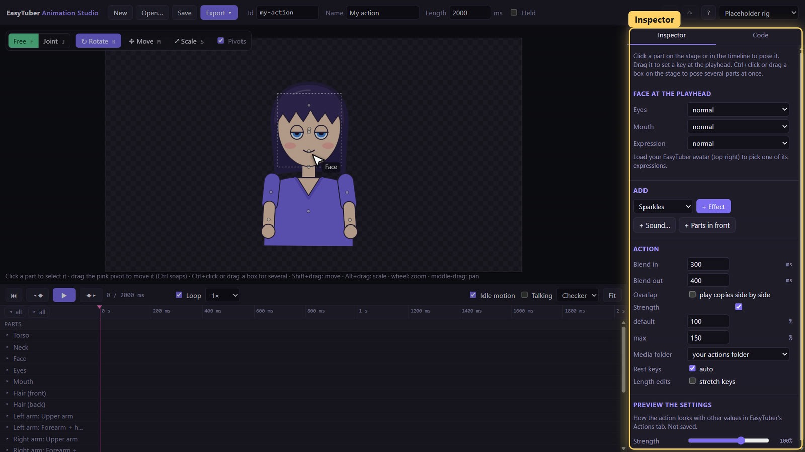

### 2. Pivots

Click a part to select it. The pink crosshair is its **pivot**: the point it turns and sizes around. In Free mode it starts in the middle of the part.


Drag the crosshair to put the pivot anywhere. Hold **Ctrl** to snap it to the part's joint, middle, edges or corners. With the pivot on the shoulder, the upper arm turns like a real arm.

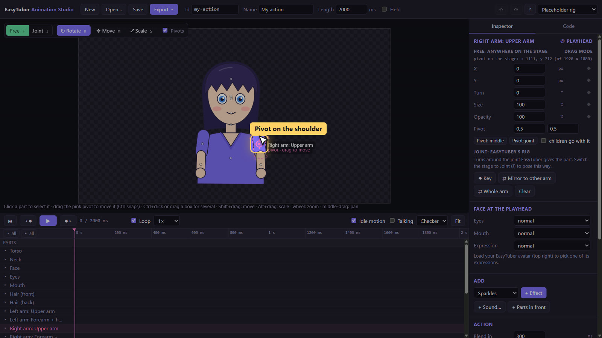

### 3. Move, turn, size and fade

**Move** (`M`, or hold Shift) puts a part anywhere on the 1920×1080 stage; the label shows where its pivot is, in stage pixels. **Rotate** (`R`) turns it around its pivot (Ctrl snaps to 15°). **Scale** (`S`, or hold Alt) grows it when you drag up and shrinks it when you drag down. **Opacity** in the Inspector fades it out; 0 hides it.


Every part moves on its own. Ctrl+Z undoes anything.

### 4. Make a wave

1. Press **New**, then set the **Id** (`hello-wave`) and the **Name** (`Hello wave`). Leave the length at 2000 ms.

   

2. Put the upper arm's pivot on the shoulder and the forearm's on the elbow (select the part, Ctrl+drag the crosshair onto the joint).
3. The forearm should hang from the upper arm: select the upper arm and tick **children go with it** in the Inspector.

   

4. Keys are always set at the **playhead** (the pink line). Drag it to 500 ms on the ruler, then turn the upper arm up. The forearm comes with it.

   

5. The studio also added **rest keys** at the start and the end, so the arm rises from its normal position and comes back down by itself.

   

6. Bend the forearm at the elbow so the hand points up. Then wave: at 800 ms tilt the forearm out, at 1100 ms back in, at 1400 ms out again.

   

7. To keep the upper arm up while it waves, go to 1500 ms, select it and type `-100` into **Turn** in the Inspector. A typed number sets a key at the playhead, just like a drag. Press **Space** to play.

### 5. Refine in the timeline

Click **▸** next to a part to open its X, Y, Turn, Size and Opacity rows. Drag a key left or right to retime it.

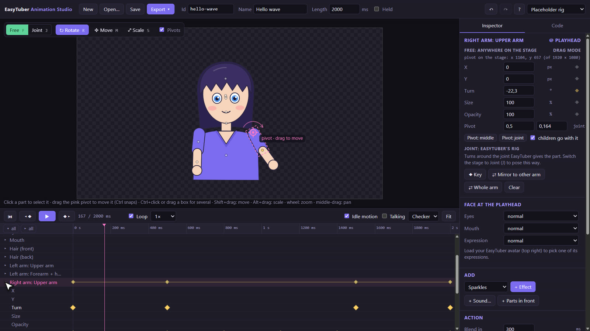

Right-click a key to pick its **easing**, how the motion travels to the next key. *outBack* overshoots a little, which feels bouncy.

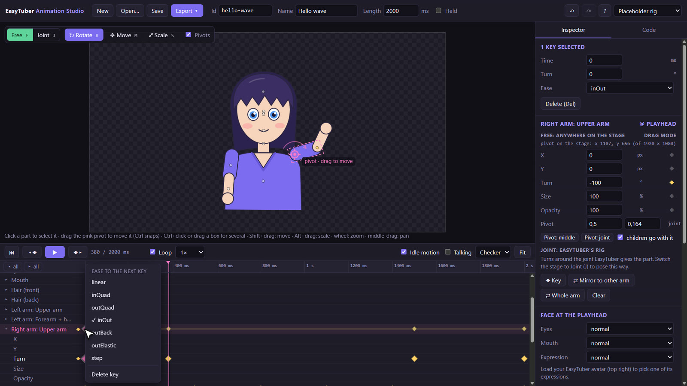

Drag over empty timeline to draw a box: every key inside it is selected, face keys too. Drag any of them to move them all, or change their easing or value in the Inspector at once. Double-click a row to add a key; **Delete** removes the selected keys; **Esc** clears the selection.


### 6. Several parts at once

Ctrl+click parts, or drag a box over empty stage, to select several. A drag then moves, turns or sizes them as one group around the pivot of the part you grab. **K** keys every selected part; **Ctrl+A** selects every part.

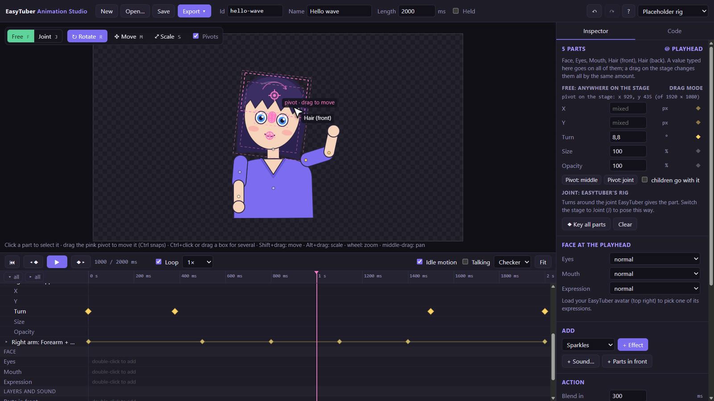

### 7. Eyes, mouth and expressions

**Face at the playhead** in the Inspector sets the eyes, mouth and expression from the playhead on. Here the eyes close at 600 ms for a happy squint and go back to **normal** at 1400 ms. *Normal* hands blinking and talking back to EasyTuber. Your own expressions show up in the list when you preview on your avatar.

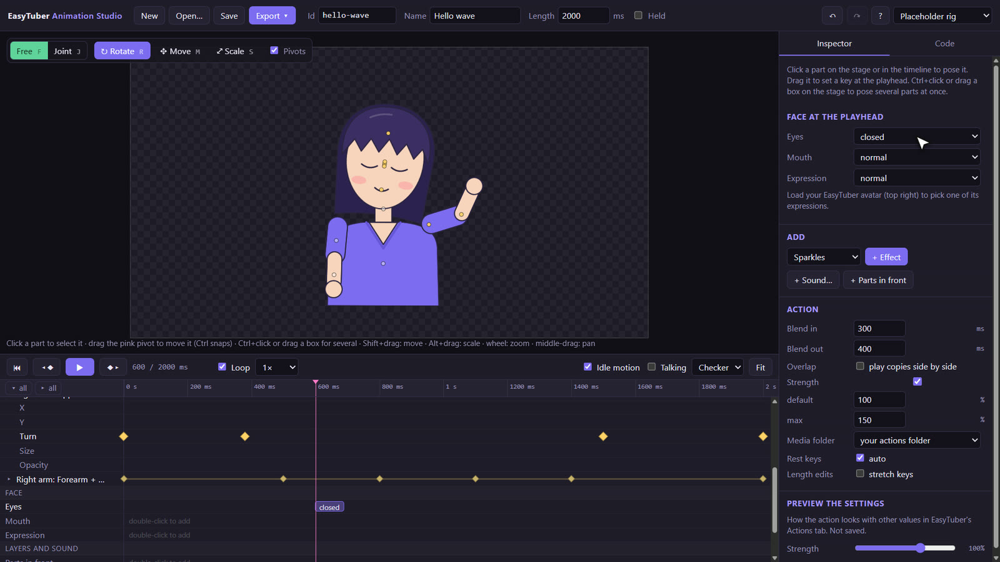

### 8. Effects, sounds and layers

Pick an effect in **Add** (sparkles, music notes, motion marks, emoji burst, caption, your own picture) and press **+ Effect**. It shows as a bar in the effects rows: drag it to move it, drag its ends to change when it starts and stops. Each effect sits on a point of a part: press **⌖ Pick** and click the avatar.

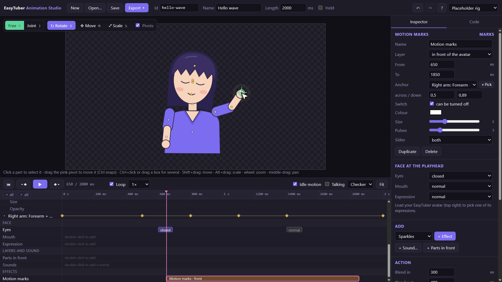

Every effect gets its own switch in EasyTuber, so it can be turned off later without editing the action. **+ Sound…** adds a sound at the playhead (copied next to the action on export). **+ Parts in front** draws chosen parts over the rest for a while, for an arm reaching across the face.

### 9. Action settings and held actions

The **Action** card holds blend in / out (the fades only show while playing; paused, the stage shows the pose at full strength), the **Strength** slider EasyTuber shows, rest keys and the media folder.

Tick **Held** for an action that stays on until it is turned off, like a "be right back" pose. The green bar on the ruler is the loop: after playing through once, the action repeats that part. **Turn on** / **Turn off** preview it the way EasyTuber plays it.

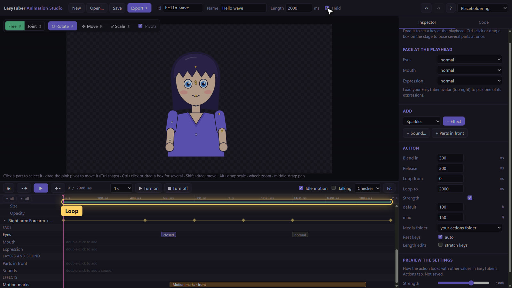

Pick **My EasyTuber avatar** (top right) to preview on your own avatar, including parts you added.

### 10. Export to EasyTuber

The **Code** tab shows the file the studio wrote; any problems are listed at the top.


**Export > Save action as…** (Ctrl+E) writes `hello-wave.js`. In EasyTuber, open the **Actions** tab, click **Open actions folder**, put the file there (and its media folder, if it has one), and press **Reload actions**. The action is then ready for a hotkey or Streamer.bot. Save the project too (Ctrl+S); an exported `.js` can also be opened again for editing.

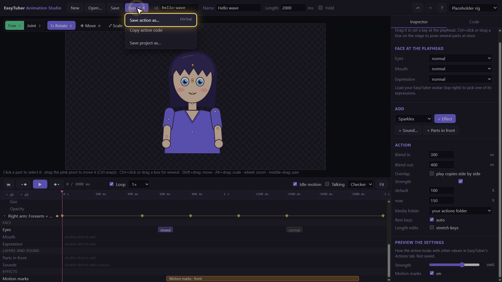

The **?** button lists every shortcut.

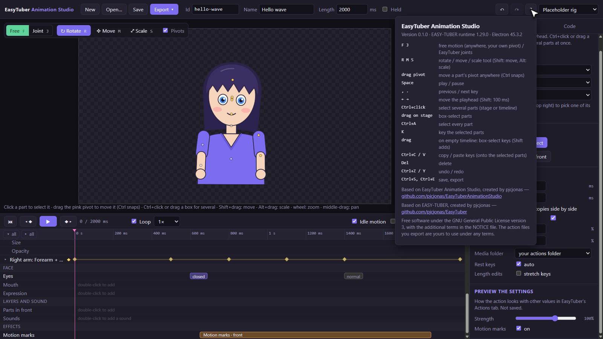

## Free motion: every part, anywhere

In **Free** mode (the default, `F`) every part is its own layer on the 1920×1080 stage. Move it anywhere, turn it, size it, fade it. Nothing is attached to anything: moving the torso leaves the head and arms where they are. If you do want the parts hanging from a part to come along, tick **children go with it** for that part.

Each part turns and sizes around its **pivot**, the pink crosshair. It starts in the middle of the part. Drag it anywhere, even outside the part; hold Ctrl to snap it to the part's joint, middle, edges or corners. A pivot on the joint is stored as "the joint", so it fits any avatar the action plays on. Turn or scale several selected parts and they move as one group around the pivot of the part you grabbed.

**Joint** mode (`J`) is EasyTuber's own rig motion instead: parts turn around the joints set up in EasyTuber's Part tab, and children always follow.

## Making an action

1. Set the **Id** (the file name, letters/digits/`-`/`_`), the **Name** and the **Length** at the top. Tick **Held** for an action that stays on until it is turned off.
2. Move the playhead (click or drag the ruler) and pose parts on the stage with the tool picked at the top left of the stage:
   - **Move** (`M`, or hold Shift): put a part anywhere on the stage. The label shows where its pivot is, in stage pixels.
   - **Rotate** (`R`): turn a part around its pivot (Ctrl snaps to 15°).
   - **Scale** (`S`, or hold Alt): drag up to grow, down to shrink.
   - **Opacity** is in the Inspector: 0 hides the part.
   - paused, the stage shows the pose at the playhead at full strength. The blend in/out fades only show while playing, exactly as in EasyTuber.
   - every drag sets a key at the playhead. The first key on a track also adds rest keys at the start and end, so the part moves out of rest and back (turn this off under **Action > Rest keys**).
   - **several parts at once:** Ctrl+click parts (on the stage or their names in the timeline), drag a box on empty stage, or press Ctrl+A. A drag then moves them all by the same amount, or turns or scales them as one group around the pivot of the part you grabbed. A value typed in the Inspector goes on all of them, **K** keys them all, and pasting one part's keys puts them on every selected part.
3. Refine in the **timeline**: drag keys to retime them, right-click for easing, double-click a row to add a key, **Delete** to remove. Click **▸** on a part to see its Rotate / Move / Scale rows. Drag a box over empty timeline to select every key inside it, across parts and the eyes / mouth / expression rows (Shift adds to the selection; Shift+click picks single keys). Drag any selected key to move them all together, or set their easing or value at once, move them by a number of ms, or delete them. A click on empty timeline moves the playhead; drag the ruler to scrub.
4. **Face**: eyes, mouth and expression keys (expressions come from your avatar). A key set to **normal** hands the face back to EasyTuber's blinking and talking.
5. **Add** effects (sparkles, music notes, motion marks, emoji burst, caption, your own picture), sounds, and **parts in front** (an arm reaching across the face). Effects sit on a point of a part: pick it on the stage with **⌖ Pick**.
6. **Action** settings: blend in/out, the **Strength** slider EasyTuber shows, the held loop and release, and the media folder.

Pick **My EasyTuber avatar** (top right) to preview on your own avatar, including your own parts. It is read from `%APPDATA%\EASY-TUBER` (macOS: `~/Library/Application Support/EASY-TUBER`), read only.

Keys (also under **?** in the app): `F` `J` free / joint motion · `R` `M` `S` rotate/move/scale tool · `Space` play/pause · `,` `.` previous/next key · `←` `→` nudge the playhead (Shift ×10) · `Ctrl+click` / box: select several parts · `Ctrl+A` every part · `K` key the selected parts · drag on empty timeline: box-select keys (Shift adds) · `Del` delete · `Ctrl+C`/`Ctrl+V` copy/paste keys · `Ctrl+Z`/`Ctrl+Y` · `Ctrl+S` save · `Ctrl+E` export.

## Tutorial video

`npm run tutorial` records a narrated walkthrough of the real app (Windows): it speaks each line with a Windows voice, drives the studio with a visible cursor and captions, and writes `tutorial/EasyTuberStudio-tutorial.mp4` and an `.srt`. It uses the US English voice Mark, or else David (install **English (United States)** under **Settings > Time & language > Speech**); pick another with `--voice`, or record some chapters with `--chapters 3-5`. Needs ffmpeg. The narration and the on-screen steps are in `scripts/tutorial/script.js`.

`npm run screenshots` runs the same steps without narration and saves the walkthrough pictures above into `docs/images/` (the chapter on your own avatar is skipped, so it never ends up in them).

## Getting it into EasyTuber

**Export > Save action as…** writes `<id>.js`. If the action has sounds or pictures, it also copies them into an `<id>/` folder beside it. Move both into EasyTuber's actions folder (**Actions tab > Open actions folder**) and press **Reload actions**. **Copy code** puts the file's text on the clipboard instead.

The exported file is plain, readable JavaScript: keyframes as data plus a small sampler, following `js/actions/README.md` in the EasyTuber repo. It also carries the studio project as a comment at the end, so **Open…** can load an exported `.js` back for editing. That comment holds no file paths from your computer. Projects can also be saved as `.etaction.json`.

## When EasyTuber changes

```
npm run sync-runtime            # copies ../EasyTuber/js/{util,defs,placeholder,assets,animator,actions,renderer}.js
npm run sync-runtime -- <path>  # from another checkout
```

## Layout

| | |
|---|---|
| `build/` | app icons (`npm run icon` redraws them) |
| `electron/` | window, `app://` pages (studio files, avatar pictures, the action's media), file dialogs |
| `runtime/easytuber/` | EasyTuber's runtime, unmodified (`VERSION` says which) |
| `src/interp.js` | easing and sampling. The same text is pasted into every exported file. |
| `src/model.js` | the project format and keyframe editing |
| `src/codegen.js` | project → action file, and back |
| `src/effects.js` | effect presets |
| `src/preview.js` | the frame loop around EasyTuber's renderer and action engine |
| `src/stage-tools.js`, `src/timeline.js`, `src/inspector.js`, `src/app.js` | the editor |

## Releases

Push a tag like `v0.2.0` and GitHub Actions builds the Windows and macOS apps and publishes them as a release. See [RELEASING.md](RELEASING.md); changes are listed in [CHANGELOG.md](CHANGELOG.md).

## Licence

EasyTuber Animation Studio is free software under the [GNU GPL version 3](LICENSE) with the additional terms in [NOTICE](NOTICE). It includes files from EASY-TUBER (in `runtime/easytuber/`), under EASY-TUBER's own licence.

The action files you export are yours: the code the studio writes into them may be used under any terms.

Based on EASY-TUBER, created by pjcjonas — https://github.com/pjcjonas/EasyTuber
